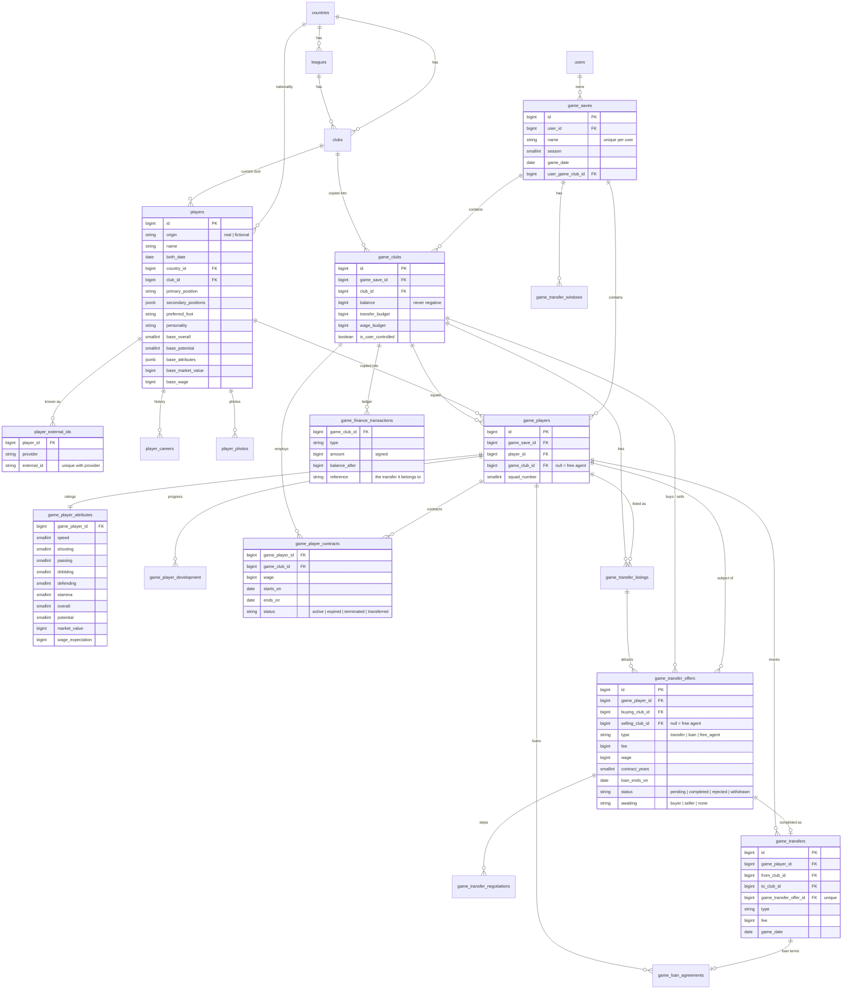

# Database diagram

## Constraints that guard the data

| Rule | Enforced by |
|---|---|
| An external record is imported once | unique (`provider`, `external_id`) on `player_external_ids`, `clubs`, `leagues` |
| A player appears once per save | unique (`game_save_id`, `player_id`) on `game_players` |
| Clubs and players in a deal, contract, listing or ledger line belong to the same save | composite foreign keys (`id`, `game_save_id`) |
| A balance or budget is never negative | check constraints on `game_clubs` |
| One running contract, one active listing, one active loan per player | partial unique indexes on `status = 'active'` |
| One open offer per club and player | partial unique index on `status = 'pending'` |
| An offer is completed once | unique `game_transfer_offer_id` on `game_transfers` |
| One user-controlled club per save | partial unique index on `game_clubs` |
| A shirt number is worn once per club | partial unique index on `game_players` |
| Positions, origins, statuses, rating ranges, date order | check constraints |
